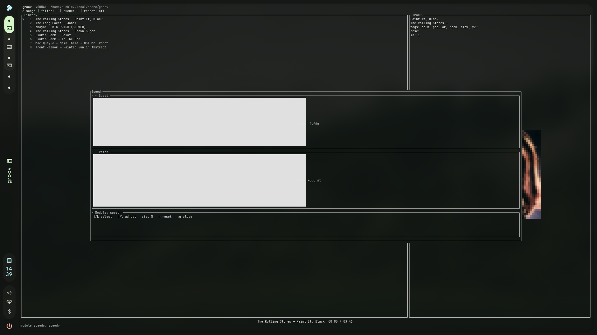
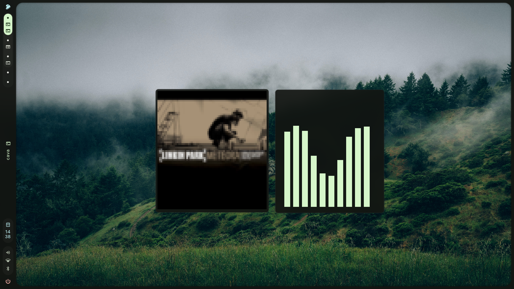
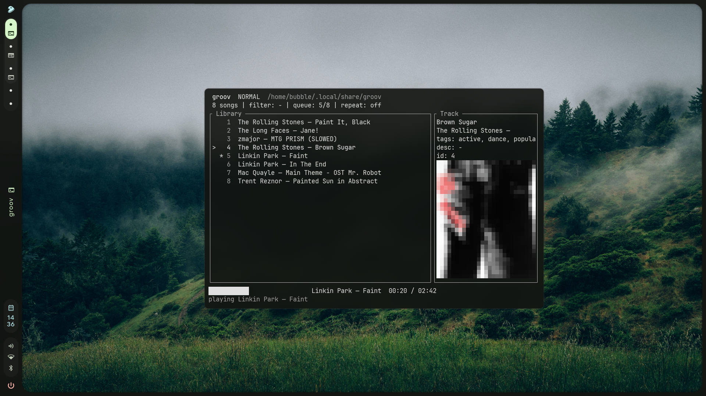
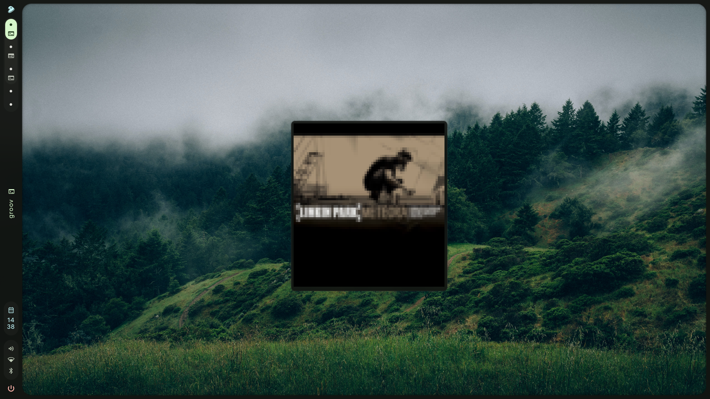

# groov

`groov` is a local music player for people who prefer a keyboard. It is a Vim-like TUI with a directory-based library, tag filters, cover art, a configurable audio backend, named themes, and a language-independent module API. The screen is rendered through Ratatui's buffered diff renderer, so unchanged cells are not rewritten on every timer tick.

Current release: `1.0.0`. See [CHANGELOG.md](CHANGELOG.md) for release notes and [LICENSE](LICENSE) for the MIT license.

<p align="center">
  
  
</p>

<p align="center">
  
  
</p>

## Installation

### Dependencies

For a normal source build you need Rust/Cargo and mpv for the recommended live playback path. FFmpeg/ffplay remains a fallback, and Python 3 is needed by the optional `basic_modules` modules.

On Debian or Ubuntu:

```sh
sudo apt update
sudo apt install --yes ffmpeg mpv python3
curl --proto '=https' --tlsv1.2 -sSf https://sh.rustup.rs | sh
. "$HOME/.cargo/env"
```

On macOS:

```sh
/bin/bash -c "$(curl -fsSL https://raw.githubusercontent.com/Homebrew/install/HEAD/install.sh)"
brew install ffmpeg mpv python
curl --proto '=https' --tlsv1.2 -sSf https://sh.rustup.rs | sh
. "$HOME/.cargo/env"
```

The Rust installer can be skipped when `rustc --version` and `cargo --version` already work. `ffprobe` is optional; when present, `groov add` reads embedded title, artist, album, and duration metadata.

On macOS, install the small Command Line Tools package with `xcode-select --install` only if `cargo build` reports that the system linker or `cc` is missing; the full Xcode application is not required by groov.

### Build and install

You can install manually with `make` and `make install`, or use the repository installer. The script builds the release binary and installs it with the man page; it does not need root when using the default user prefix:

```sh
./install.sh
```

To install elsewhere:

```sh
PREFIX="$HOME/.local" ./install.sh
```

```sh
git clone https://github.com/bluetoothpaste1/groov.git
cd groov
make
make test
make install PREFIX="$HOME/.local"
export PATH="$HOME/.local/bin:$PATH"
groov init
groov
```

The install target and `install.sh` place the release binary in `$PREFIX/bin` and the man page in `$PREFIX/share/man/man1`. To remove those installed files, run `make uninstall PREFIX="$HOME/.local"`. To remove groov's user library, settings, modules, themes, and cache, run `groov uninstall` and confirm with `yes`.

For a development checkout without installing:

```sh
make
./target/debug/groov init
./target/debug/groov
```

The project CI checks Rust on Linux and macOS, documentation links, formatting, clippy, tests, and release builds.

Tagged builds use the `vX.Y.Z` convention. GitHub Actions packages Linux and macOS release archives with the architecture in the filename.

The application is implemented in Rust; audio playback and optional extensions remain separate external processes.

## Build and run

```sh
make
make test
make docs-check
make release
./target/debug/groov add ~/Downloads/song.mp3
./target/debug/groov add ./keep-a-copy.mp3 --copy --tag archive
./target/debug/groov
```

Useful commands are `groov list`, `groov list --tag rock --tag night`, `groov scan`, `groov doctor`, `groov paths`, `groov theme list`, `groov theme install FILE`, `groov theme use NAME`, `groov modules`, and `groov uninstall`. `groov add` accepts `--album`, `--image`, `--lyrics`, `--id`, `--copy`, and `--dry-run` as well. By default it moves the source file; `--copy` keeps the original in Downloads, while `--dry-run` only prints the planned import. If `ffprobe` is installed, title, artist, album, and duration are read automatically. `groov edit 13 --title "New title" --tag live --untag draft` updates an existing song atomically.

`groov uninstall` permanently removes groov's configuration, modules, themes, cache, and complete local library, including audio, covers, metadata, and lyrics. It prints every target path and requires an explicit `y` or `yes` confirmation; any other answer cancels the operation. The installed executable is left in place so the command can finish safely.

## Files and directories

groov follows the XDG layout:

```text
~/.config/groov/settings.json       configuration
~/.local/share/groov/songs/         GDD (Groov data directory)
~/.cache/groov/                     generated/cache data
```

`XDG_CONFIG_HOME`, `XDG_DATA_HOME`, and `XDG_CACHE_HOME` override these defaults. A song is self-contained:

```text
songs/13/song.mp3
songs/13/info.json
songs/13/image.jpg       optional (png, jpg, jpeg, webp)
songs/13/lyrics.txt      optional
```

`info.json` uses the requested capitalized keys (`Artist`, `Lyrics`, `Title`, `Album`, `Image`, `Tags`) and also accepts `Duration` and `AddedAt`. `Tags` are normalized to lowercase and duplicate tags are removed. `groov list --tag a --tag b` uses AND semantics.

## Controls

groov has two view modes: `NORMAL` shows the library and full playback controls, while `COMPACT` renders only the current track's cover. Use `:mode compact` to enter it and `:mode normal` to return. In compact mode `j/k` or the arrow keys immediately start the next/previous visible track, `h/l` seek, and `Space` pauses or resumes playback. The separate `COMMAND` input state opens with `:`; search and help are commands/panels. Normal mode uses `j/k` or arrow keys to move, `Space` to play/pause or start the selected track, `x` to stop, `h/l` to seek by the configured skip interval, `n`/`]` and `[` for queue navigation, `a` to enqueue, `/` to enter `:search`, `?` for help, and `q` to quit. `Esc` cancels the current transient state and does not quit the application. Commands include `:mode normal|compact`, `:follow on|off`, `:tag live`, `:untag draft`, `:tags sad rock`, `:repeat on`, `:repeat off`, `:set title "New title"`, `:set desc "A favorite track"`, `:set artist "Rock group"`, `:set image ~/cover.jpg`, `:set lyrics ~/lyrics.txt`, `:set skips 10`, `:set coversize 16`, `:set theme ocean`, `:reload`, `:queue`, `:enqueue`, `:next`, `:prev`, `:clear`, `:play`, `:stop`, `:rescan`, and `:q`.

Cover art is rendered by `ratatui-image` into one fixed square area. The full source image is scaled directly into that area without cropping or empty padding. `image_mode: "auto"` deliberately uses ANSI half blocks, which work in Linux and macOS terminals, SSH, tmux, and IDE terminals. Sixel, Kitty, and iTerm2 are explicit opt-ins (`sixel`, `kitty`, `iterm2`); `none` disables images. The audio command is configurable through `{file}`, `{start}`, and the module-facing `{audio_filter}` placeholder; its standard streams are isolated so backend output cannot corrupt the TUI. groov always restores raw mode and the alternate screen when the terminal or player exits with an error.

While a track is playing, the TUI shows its elapsed time and progress bar. `h` and `l` seek backward or forward by `skip_seconds` (5 seconds by default); `:set skips 10` changes and persists that interval. `:repeat on` repeats the current track when it ends; `:repeat off` returns to normal queue progression. The repeat setting is persisted in `settings.json`.

`:follow on` keeps the selected library row aligned with the track that starts playing, including automatic queue transitions. `:follow off` preserves manual selection; the setting is persisted in `settings.json`.

In command mode, `Tab` completes command names, `set` fields, and paths for `image`/`lyrics`. Path completion understands both absolute paths and `~/...`.

Interactive module views use the same command line: press `:` and use `:q` or `:close` to close the active view. Normal keys are forwarded to the module. RPC modules can also draw arbitrary cell-based canvas layers with text, colors, fills, lines, borders, z-order, percentage geometry, and modal/non-modal input. Host-driven `animation` responses run locally at up to 240 FPS without a JSONL round-trip per frame; `canvas_patch` updates only changed commands. For a completely independent Ratatui or crossterm application, mark a command module with `"terminal": true`; groov temporarily releases the terminal and restores its TUI after the module exits.

Settings can enable external modules with `modules[].command`; they receive playback events through `GROOV_EVENT`, `GROOV_EVENT_JSON`, `GROOV_SONG_ID`, and `GROOV_SONG_FILE`. A module can expose command aliases (`commands`) and key bindings (`keys`), set environment variables (`env`), choose a working directory (`cwd`), enable JSONL RPC views (`rpc`), keep a streaming RPC process (`session`), run a direct terminal application (`terminal`), request host ticks (`fps`), receive resize/mouse input (`mouse`), and restrict events with `events`. RPC modules can return status, overlays, paragraphs, lists, gauges, declarative widget trees, cell-based canvas layers, host-driven animations, incremental patches, input handling, generic playback actions, and redraw messages to the TUI. Standalone modules are discovered from `~/.config/groov/modules/<name>/module.json` and use their manifest directory as the default working directory, so a module can be written in Rust, Python, Lua, shell, or any other language without changing groov. The module process contract is versioned with `GROOV_API_VERSION=1`. A canvas reference module lives in [`examples/modules/canvas_overlay`](examples/modules/canvas_overlay/).

Manage modules from COMMAND mode with `:modules` or `:modules list`, `:modules on NAME`, `:modules off NAME`, and `:modules info NAME`. For installed extensions, use `groov modules install DIRECTORY` (or `groov module add DIRECTORY`), `groov modules remove NAME`, and `groov modules enable|disable NAME`. The module panel shows the manifest path, working directory, metadata, commands, key bindings, events, and environment. A complete reference extension lives in [`examples/modules/hello`](examples/modules/hello).

The repository also includes independent, ready-to-copy extensions in [`basic_modules`](basic_modules): `flame` animates border colors, `easyadd` provides an interactive track-import form, and `speedr` demonstrates generic playback control with live speed, pitch, and reverb changes.

Themes are built in (`monochrome`, `ocean`, `gruvbox`, `nord`, `dracula`, `solarized`, `catppuccin`, `tokyo-night`, and `transparent`). Select one with `groov theme use NAME` or `:set theme NAME`; the choice is persisted in `settings.json`. Write a custom JSON theme and place it in `~/.config/groov/themes/<name>.json`, or install it with `groov theme install theme.json`. Files are loaded automatically and can be activated after `:reload`. `transparent` uses the terminal's own background (`reset`) with light-gray text and thin lines.

Полный справочник находится в [docs/README.md](docs/README.md): там есть [руководство пользователя](docs/USER_GUIDE.md), [guide по модулям](docs/MODULES.md), [справочник конфигурации](docs/REFERENCE.md), [руководство разработчика](docs/DEVELOPMENT.md) и [архитектурные решения](docs/ARCHITECTURE.md). Third-party software and attribution are listed in [CREDITS.md](CREDITS.md).
